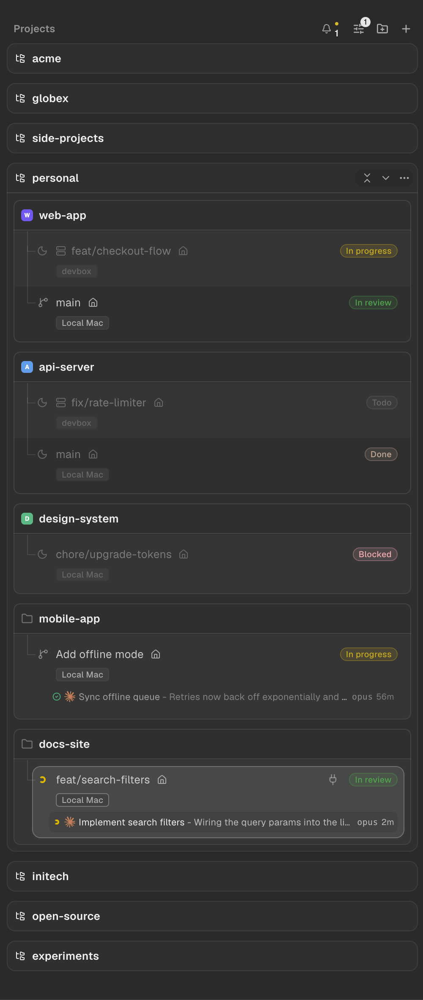
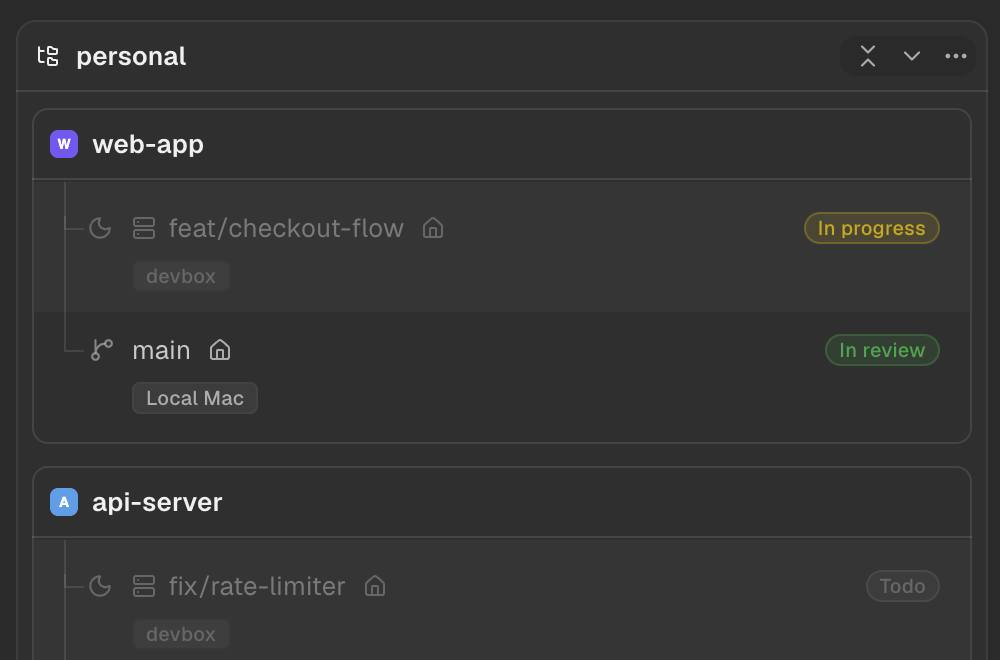

# orca-better-worktrees

Restyles [Orca](https://github.com/stablyai/orca)'s left sidebar while it runs:

- **Nested worktrees.** Worktrees move one step right of their project, with a connector from
  under the project's title into each one (and from a worktree into its child worktrees).
- **Status chip.** The workspace status you set with *Move to Status* shows on the worktree's
  title row, right-aligned, in Orca's own status colors.
- **A box per group and project.** Every group and project gets a box, with a line under its
  title; a collapsed one (or a project without worktrees) gets a box around its title alone,
  and closes along with Orca's collapse animation. Every other worktree sits on a faint band.
- **Workspace board.** Each worktree card on the board gets an edge.
- **Collapse a group's projects.** Next to each open group's actions, a button collapses its
  open projects, or expands them all when none is open (Orca's own button does this for every
  project).

## Screenshots

Project and worktree names below are made up.

<p>
  
</p>

An open group's header, with its actions shown as on hover; the first of them collapses or
expands the group's projects:

<p>
  
</p>

This is not an Orca plugin. Orca's plugin API cannot reach the left sidebar (plugins add
right-sidebar panels, themes, commands and the like), so a small command-line tool, `obw`,
injects the styles and script into the Orca that is running. Nothing in `Orca.app` is
modified, so Orca updates do not undo it, and removing it leaves Orca as it was.

## Install

You need:

- macOS, with Orca's desktop app in `/Applications/Orca.app` (tested on Orca 1.4.251);
- [Node.js](https://nodejs.org) 22 or later (`node --version` to check);
- `git`.

There is nothing to `npm install`: `obw` has no dependencies.

**1. Get the code** somewhere you will keep it. The background agent (step 3) runs the code
from this folder, so do not delete or move it afterwards.

```sh
git clone https://github.com/eliasjnior/orca-better-worktrees.git ~/orca-better-worktrees
cd ~/orca-better-worktrees
```

**2. Try it once.** With Orca open:

```sh
node bin/obw.mjs apply
```

The sidebar changes right away. This lasts until Orca quits; `node bin/obw.mjs remove` undoes
it sooner.

**3. Keep it on every time Orca opens:**

```sh
node bin/obw.mjs agent install
```

This installs a LaunchAgent: a small background process that macOS starts at login. Whenever
Orca opens, it applies the changes within a few seconds. You do not need to run `apply` again.

**4. Check that it works:**

```sh
node bin/obw.mjs agent status                     # shows "state": "running"
tail ~/Library/Logs/orca-better-worktrees.log     # shows "applied to Orca (pid …)"
```

Quit and reopen Orca: a new `applied to Orca` line appears in the log, and the sidebar is
restyled again.

## Update

```sh
cd ~/orca-better-worktrees
git pull
node bin/obw.mjs agent install
```

Installing again restarts the agent with the new code, and it applies the new version to the
Orca that is open.

## Uninstall

```sh
cd ~/orca-better-worktrees
node bin/obw.mjs agent uninstall   # stops applying when Orca opens
node bin/obw.mjs remove            # undoes it in the open Orca (or just restart Orca)
```

Then delete the folder, and `~/Library/Logs/orca-better-worktrees.log` if you like.

## Troubleshooting

- **The sidebar did not change.** Check that Orca is open, then run
  `node bin/obw.mjs stats`. It reports `"errors"` and the `"lastError"` the script hit, if any.
- **`the inspector on 127.0.0.1:9229 belongs to pid …`.** Another program is using port
  9229 (often a Node.js process started with `--inspect`). `obw` refuses to run code there;
  stop that program and try again.
- **It stopped applying after a Node.js upgrade.** The agent runs the exact Node.js it was
  installed with. If a version manager (mise, nvm, fnm) removed that version, run
  `node bin/obw.mjs agent install` again.
- **The sidebar looks broken after an Orca update.** Orca may have changed the sidebar's
  markup this relies on. Run `node bin/obw.mjs remove`, and open an issue with your Orca
  version.

## Commands

| Command | What it does |
|---|---|
| `node bin/obw.mjs apply` | Restyles the sidebar of the Orca that is open |
| `node bin/obw.mjs remove` | Undoes it in the Orca that is open |
| `node bin/obw.mjs stats` | Redraws since `apply`, their cost, and the last error |
| `node bin/obw.mjs agent install` | Installs (or restarts) the agent that applies it whenever Orca opens |
| `node bin/obw.mjs agent status` | Whether the agent is installed and running |
| `node bin/obw.mjs agent uninstall` | Removes the agent |
| `node bin/obw.mjs watch` | What the agent runs: waits for Orca and applies to every one that starts |

## How it works

Orca ships with Electron's `EnableNodeCliInspectArguments` fuse on, so `SIGUSR1` makes its main
process open the Node inspector on `127.0.0.1:9229`. `obw` opens it, evaluates
[`src/main-agent.mjs`](src/main-agent.mjs) there to inject
[`src/renderer/sidebar.js`](src/renderer/sidebar.js) (with
[`sidebar.css`](src/renderer/sidebar.css) inlined) into the main window, then closes the
inspector. While the inspector is open, any local process can run code in Orca; pass
`--keep-inspector` only while developing. Before running anything, `obw` checks that the
process behind the port is Orca's main process (9229 is Node's default inspector port, so a
dev server run with `--inspect` could hold it instead).

The sidebar is a virtualized list of absolutely positioned rows, so the script:

- classifies the rendered rows in order (group header, project header, worktree);
- marks worktree rows (`data-obw-child`) so CSS indents them, and the row that closes each box
  (`data-obw-gap`), whose bottom padding spaces the boxes apart (Orca re-measures worktree
  rows, so the rows below follow; header rows have a fixed height and cannot be padded);
- connects child worktrees listed inside a parent's card to the parent, one level deeper;
- draws boxes and connectors in one overlay under the rows, with each box's top drawn by its
  header row, so the edge follows the header when Orca makes it sticky;
- reads each worktree's `workspaceStatus` from React's props and sets `data-obw-status` on its
  title row, which CSS turns into the chip.

It only adds attributes and its own overlay. It redraws once per frame at most, after sidebar
mutations, plus a 1.5 s poll for status changes that do not touch the DOM. An update without
geometry changes costs about 0.2 ms with 20 rendered rows.

The agent runs `obw watch` under launchd, which restarts it if it stops. While the Orca it
applied to is alive, it only checks that process every 5 s, without spawning anything; when a
new Orca starts, it waits 3 s for its main process to set up, applies, and closes the
inspector.

## Develop

```sh
node bin/obw.mjs apply --keep-inspector
node bin/obw.mjs eval 'document.querySelectorAll("[data-obw-child]").length' --keep-inspector
node bin/obw.mjs shot /tmp/sidebar.png 0,200,500,760 --keep-inspector
```

`shot` saves a PNG of the window (or a rectangle of it, in window points), even when Orca is
behind other windows.

Relies on Orca's markup (`data-worktree-virtual-row*`, `data-repo-header-*`,
`data-worktree-card-status-slot`, `data-worktree-title-inline-rename`) and on worktree props
carrying `workspaceStatus`. Tested on Orca 1.4.251.
